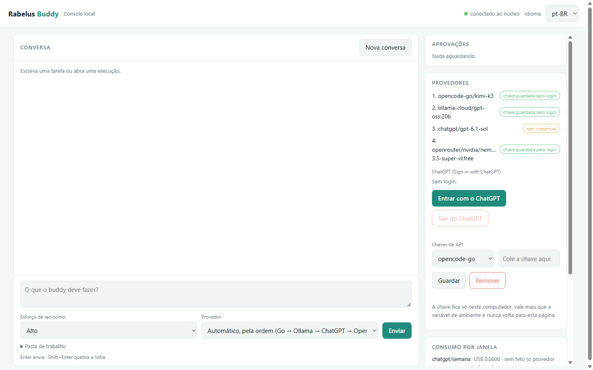
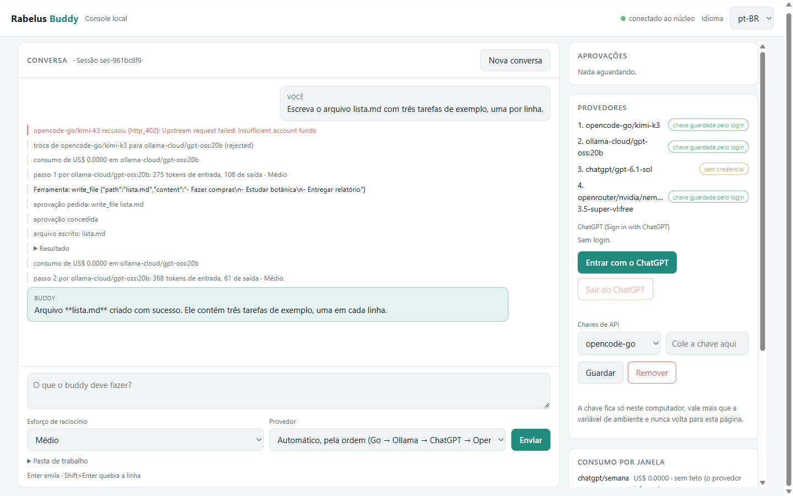
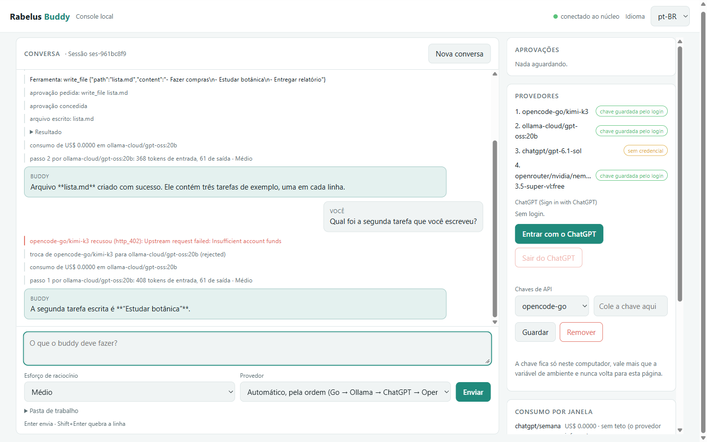
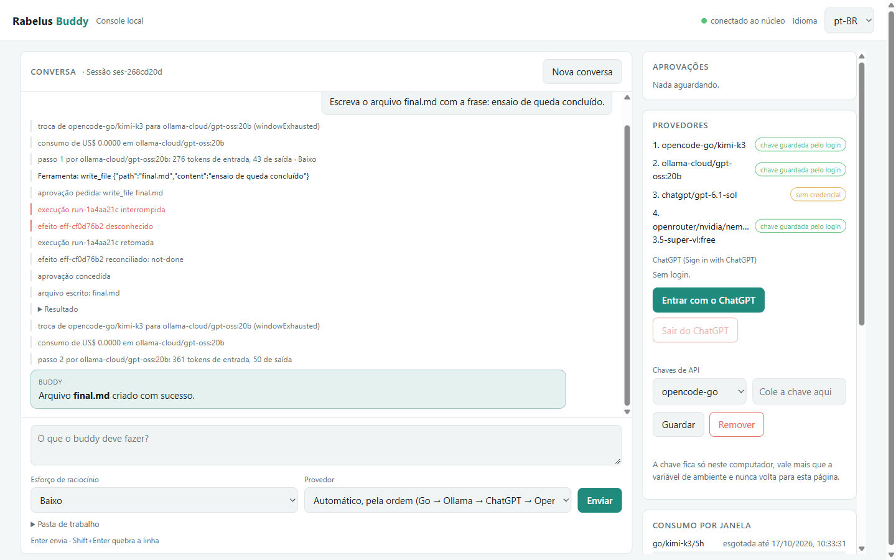
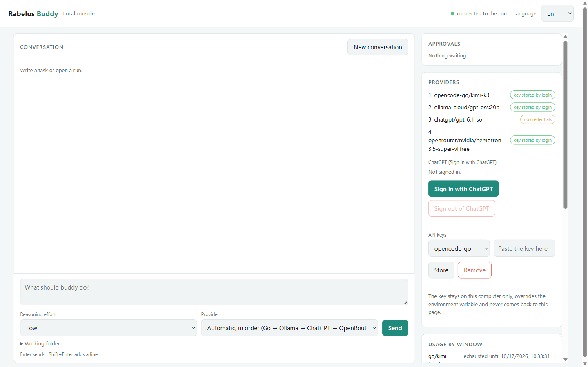
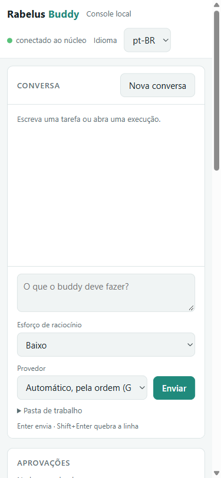

# Ensaio da console web local (M0.8c)

**Classe:** REGISTRO · **Data:** 2026-10-17T09:44:07-03:00 · **Por:** buddy-dev (sessão `claude-code-vs-code-7307c7`) · **Para:** SPEC 0001 rev. 5 (critérios 26–30), ADR 0017, validações `demonstracao-m0` e `login-chatgpt-real`

## Como foi feito

Na máquina do Pai (Windows, Node 26), num navegador real (Chromium pelo Playwright). Durante o ensaio o próprio Pai acompanhou a janela e corrigiu o rumo ("o layout está errado... cadê o input text? USE como um usuário humano usaria"). A partir daí tudo foi feito como uma pessoa faz: clicar na caixa, digitar, Enter, clicar em Aprovar, Negar e Retomar. O núcleo subiu pelo mesmo caminho do atalho (`rbuddy ui`), num diretório de estado temporário, com as chaves do `.env.local` guardadas pelo núcleo (nunca impressas).

## Passo a passo e resultado

| # | O que o Pai vai fazer | Resultado no ensaio |
|---|---|---|
| 1 | Abrir a console | conecta ao núcleo; provedores com a origem da chave; ChatGPT "sem login" |
| 2 | Escrever uma tarefa, esforço baixo, Enter | o Go recusa (`402 Insufficient account funds`, motivo à vista), troca para o Ollama, passo com "· Baixo", pedido de aprovação |
| 3 | Aprovar | escrita feita, listagem, resposta final |
| 4 | Mandar outra mensagem na mesma conversa, esforço alto | o histórico vai junto ("Estudar botânica" lembrado); com esforço alto, 3.921 tokens de saída contra cerca de 20 no baixo |
| 5 | Negar uma ação | a recusa volta ao modelo, que responde sem escrever |
| 6 | Entrar com o ChatGPT | abre a tela de login da OpenAI numa aba nova; a console mostra "aguardando"; "Sair" cancela. **Não entrei em conta nenhuma** |
| 7 | Queda do núcleo no meio de uma tarefa, subir de novo, "Retomar" | a console mostra "sem conexão" e volta sozinha; a execução aparece "interrompida"; Retomar reconcilia a chamada ou escrita incerta e termina sem duplicar |
| 8 | Queda **durante a espera da aprovação**, Retomar | uma aprovação só (a mesma de antes da queda), escrita uma vez, conclusão |
| 9 | Idioma en | todos os textos mudam |
| 10 | Celular (375 px) | sem rolagem horizontal; caixa de mensagem visível |

## Defeitos que o ensaio achou (todos corrigidos com teste antes)

1. **Caixa de mensagem no topo, longe da conversa** (apontado pelo Pai): a console virou chat, com a caixa fixa embaixo, Enter para enviar e "Nova conversa".
2. **Histórico duplicado** na conversa contínua: as mensagens copiadas ficam marcadas (`prior`) e não se repetem na tela.
3. **`**negrito**` cru** na resposta: negrito e código montados como texto, sem HTML do modelo.
4. **O Go recusava (402) a cada mensagem nova**: 402 esgota o provedor por 1 h.
5. **Queda durante a aprovação deixava duas aprovações iguais**: a pendente é reaproveitada.
6. **Execução retomada parava como "sessão pausada"**: o detector de laço contava como repetição do modelo a repetição interna depois da aprovação e a reexecução da retomada; agora conta só os pedidos do modelo.
7. **Esforço e rota se perdiam na retomada**: as opções da execução ficam no log e voltam na retomada.
8. **`favicon.ico` com 401** a cada carga: ícone vazio embutido.
9. O atalho `abrir-rabelus-buddy.cmd` saiu com caracteres de controle no caminho no primeiro rascunho; o teste pegou antes do commit.

## Capturas

     

## Limites

- O OpenRouter gratuito e o Ollama responderam; o Go recusou (402); o ChatGPT não entrou (login real é do Pai).
- O consumo do Ollama aparece como US$ 0: o plano dele (créditos) ainda não tem janela no orçamento.
- O atalho de duplo clique foi testado no conteúdo, e o caminho dele (`rbuddy ui`) foi usado no ensaio; o duplo clique em si fica para a entrega.
