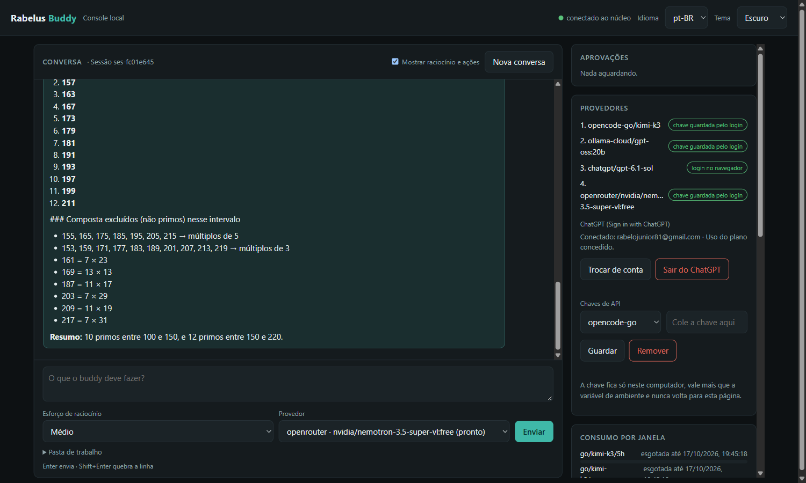

# Retrospectiva do M0 e proposta de roadmap

**Classe:** REGISTRO · **Data:** 2026-10-17T19:37:57-03:00 · **Por:** buddy-dev (sessão `claude-code-vs-code-9497ba`) · **Para:** plano do M0 (M0.9), SPEC 0001 (critério 26 e seção Métricas), ROADMAP (adendo de 2026-10-17), validação `demonstracao-m0`

## O fechamento

O Pai validou pela console, em 2026-10-17, nas palavras dele: "testei todo o resto". Antes disso:
- fez o login real do ChatGPT;
- usou ChatGPT, Ollama e OpenRouter em conversas reais, com esforço Alto, aprovações e negações;
- apontou o que viraram a M0.8d e o tema.

Os ensaios do buddy-dev que precederam cada entrega ao Pai estão registrados:
- [console](../2026-10-17T094406-0300-ensaio-da-console-web-local/README.md);
- [hotfix do ChatGPT](../2026-10-17T164021-0300-chatgpt-sem-resposta-na-console-hotfix-ensaiado/README.md);
- [M0.8d](../2026-10-17T185732-0300-ensaio-da-m0-8d-andamento-ao-vivo-e-fila/README.md).

**Limite declarado:** o buddy-dev não observou a sessão final de testes do Pai. A validação é a declaração dele.

## Métricas (SPEC 0001, seção Métricas; medidas no núcleo real do Pai em 2026-10-17)

Fonte: log do núcleo (12 sessões, 38 execuções) e 200 chamadas de IPC ao dono real (`workspace/metricas-m0.ts`, fora do git; só números agregados).

| Métrica | Valor |
|---|---|
| Execuções | 38: 36 concluídas, 1 parada pelo usuário, 1 interrompida (reinício do núcleo feito pelo buddy-dev durante um ensaio) |
| Consumo em US$ reais | US$ 0,24 no total, todo de chamadas do Go antes de a conta ficar sem saldo. ChatGPT e Ollama rodam na assinatura, e o OpenRouter usou modelo gratuito |
| Passos por execução | p50 1 · p95 4 · máximo 15 (contar palavras de um documento pela Ollama, ferramenta a ferramenta) |
| Aprovações por execução | média 0,45 (17 no total) |
| Duração da chamada ao modelo | ChatGPT p50 3,3 s · p95 125 s · máx. 248 s (esforço Alto) · Ollama p50 1,6 s · p95 12 s · OpenRouter p50 17 s · p95 151 s |
| Latência do IPC (dono real) | p50 0,36 ms · p95 1,12 ms |
| Compactação de contexto | nenhuma no uso real (nenhuma conversa passou de 100 mil tokens estimados); coberta pelo critério 21 nos testes |
| Trocas de provedor por esgotamento | 4, todas do Go (conta sem saldo, 402) |
| Raciocínio registrado, fila, parada | 3 passos com raciocínio no log; 1 mensagem enfileirada e direcionada; 1 parada pelo usuário |

Tamanho do M0: PRs #17 (SPEC) a #40, em 3 dias (15 a 17 de outubro); 246 testes.

## O que funcionou

- **SPEC → teste → código, sem exceção.** Cada critério virou teste antes do código, e nenhum teste foi afrouxado. Quando um contrato mudou (a rev. 6 pede `summary` junto do esforço), a asserção mudou com a mesma força.
- **O núcleo aguentou o mundo real:** um dono só, IPC sub-milissegundo, efeitos com identidade, retomada depois de `kill -9` sem escrita duplicada, e provedores trocando sozinhos quando a conta recusa.
- **Regra nova sempre com mecanismo:** ensaio antes de pedir ao Pai (`bd validacoes`), claim antes de editar documento vivo (`bd claims`), teste íntegro (`bd test-guard`).

## O que não funcionou, e o que mudou

1. **Servidor falso provou o contrato que eu imaginei, não o mundo**, três vezes num só dia: o host id do SIWC, o 403 do Go e o evento final vazio do ChatGPT. → AGENTS §5.9: integração externa só se declara pronta depois de checada contra o serviço real, e o teste copia a **sequência** medida.
2. **Pedi ao Pai um teste por terminal que eu não tinha ensaiado.** → O produto é UX/UI. Nenhuma ação chega ao Pai sem ensaio meu no ambiente dele (mecanismo no `bd validacoes`).
3. **Os testes não viam o que a pessoa vê.** Cada ensaio no navegador real achou defeitos que a suíte inteira deixava passar: 9 na console, 4 no hotfix, 8 na M0.8d e 1 no tema. → O ensaio no navegador faz parte da sub-fase.
4. **Silêncio parece defeito.** Foram 248 s sem sinal, e o Pai achou que tinha quebrado. → Andamento ao vivo (M0.8d).
5. **A governança relaxou no fim do dia.** Fiquei numa sessão velha e editei sem claim. → `bd claims`. No próprio fechamento, achei que ele não cobria o ROADMAP e o PLANO-MACRO, e o corrigi com teste.

## Lacunas que ficam (declaradas)

- O Go está sem saldo (402) desde a manhã, e o caminho dele não rodou em fluxo real.
- O resumo do raciocínio do ChatGPT é intermitente, por decisão do serviço.
- A janela de orçamento da Ollama não existe: o consumo dela aparece como US$ 0.
- A validade da chave não é sondada ao guardar.
- A queda do núcleo com fila foi testada (`kill -9`), mas não ensaiada no navegador.
- A rolagem automática do raciocínio ao vivo está coberta por teste, mas não foi observada na tela.

## Proposta de roadmap (decisão do Pai)

O adendo de 2026-10-17 prometeu propor, no fechamento do M0, o novo lugar da interface de produto e dos demais marcos. O que o M0 ensinou:
- a superfície é onde aparecem os defeitos que importam;
- o Pai pensa o produto como agente **multimodal com UX/UI**;
- o núcleo hoje só entende texto, e os provedores já aceitam imagem (`gpt-6.1-sol`, `nemotron-3.5-super-vl`, a ser verificado ao vivo antes de prometer);
- comandos livres no computador ainda pedem aprovação um a um, porque não há isolamento.

| Opção | Ordem | A favor | Contra |
|---|---|---|---|
| **A — Manter** | M1 ACP → M2 isolamento → M3 memória → M4 canais → M5 superfícies; a console evolui dentro de cada marco | nenhuma reorganização; plano macro intacto | a interface de produto e o multimodal ficam para o fim, contra a direção do Pai |
| **B — Interface primeiro** | M1 interface de produto (ADR 0013, Expo universal) + multimodal → M2 ACP → M3 isolamento → M4 memória → M5 canais | aposta forte na UX | troca a console, que funciona, por uma pilha nova antes de haver o que mostrar; dependências novas e grandes cedo |
| **C — Console como produto, multimodal cedo** (recomendada) | **M1** agentes por ACP **e** multimodal de entrada na console (anexar imagem e arquivo à conversa), tudo demonstrado pela console → **M2** isolamento (comandos sem aprovação um a um) → **M3** interface de produto (ADR 0013) nascida da console, com voz → **M4** memória e identidade → **M5** canais → **M6+** o resto | entrega a direção do Pai (multimodal com UI) já no próximo marco, sem trocar de pilha; a console continua sendo onde cada marco se prova; o isolamento vem antes de a interface de produto prometer autonomia | adia memória e canais em um marco |

**Recomendação: C.** O roadmap e o plano macro **não mudam** até a decisão. A proposta está registrada no adendo do ROADMAP, e a validação `roadmap-pos-m0` aguarda o Pai.

